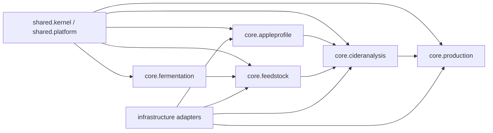

# CAP Architecture Documentation

This file is a repository-local mirror of the operational project documentation kept in the
Obsidian knowledge base. The Obsidian document remains the richer planning source; this file gives
backend contributors a short, code-adjacent map.

Knowledge-base source:

`/Users/paul/Documents/Obsidian/mcs/20-Projects/Cider-Analytical-Platform/CAP Project Documentation.md`

## Product Scope

CAP is a decision-support platform for cider makers and technologists. It helps evaluate apple
varieties and feedstock batches, plot chemical profiles, score profiles against targets, calculate
source compositions, optimize candidate compositions and commit production batches.

CAP is not a marketplace: no orders, payments, reservations, delivery, prices or contracts.

## Bounded Contexts

## Context Responsibilities

### Shared Kernel

Canonical measurements and cross-context primitives:

- sugar as specific gravity;
- acidity as g/L as malic acid;
- tannin as mg/L;
- `ChemicalProfile`, `ChemicalProfileAxes`, capability model;
- cursor/query platform helpers.

### Apple Profile

Catalog-level apple varieties. `AppleVariety` is a pomological aggregate, not a harvest lot or
regional observation.

Important use cases:

- create variety;
- classify by built-in systems;
- calculate North American profile;
- assess/query sugar-acidity graph points.

### Feedstock

Workspace stock lots and measurement history.

`FeedstockBatch` owns season, source and available volume. `FeedstockMeasurement` owns chemical
profile observations over time.

Current-profile rule:

> Current feedstock batch profile is the latest measurement by `measuredAt`, with `measurementId`
> as deterministic tie-breaker.

### Cider Analysis

Reusable analytical logic:

- cider classification strategies;
- sugar-acidity zones and graph metadata;
- profile target scoring;
- chemical profile composition calculation;
- composition optimization.

The context is scenario-neutral and should not depend on REST, JPA or workspace ownership.

### Production

Committed production lots. `ProductionBatch` stores source composition and a chemical profile
snapshot at creation time, because source measurements can change later.

### Fermentation

Currently potential ABV prediction. Future direction: yeast catalog, fermentation time-series,
alerts and process guidance.

## Primary User Journeys

### Feedstock Workspace

Create batch -> add measurements -> complete missing values -> use latest measurement as current
profile -> show graph/ABV/warnings -> score against target.

### Technologist Composition Planning

Filter candidate batches -> select target -> choose scoring/optimization settings -> calculate or
optimize composition -> explain distance/warnings -> commit production batch.

### Catalog Data Quality

Import/create varieties -> assess missing capabilities -> report incomplete profiles -> enrich or
keep partial -> expose usable records in catalog discovery.

## Code Documentation Rules

Add Javadoc to:

- aggregate roots;
- application services;
- public inbound port packages and important use-case ports;
- domain records that carry semantic results or mathematical inputs;
- strategies, calculators, selectors and objective functions.

Javadoc should explain responsibility, semantic boundary, use-case role and important invariants.
Avoid comments that only restate method names.

The Gradle `javadoc` task keeps doclint checks for correctness but disables the `missing` category
so simple DTO components and generated adapter shapes do not force noisy boilerplate comments.

## Key Locations

- `src/main/java/org/craft/mcs/cap/shared/kernel`
- `src/main/java/org/craft/mcs/cap/shared/platform`
- `src/main/java/org/craft/mcs/cap/core/appleprofile`
- `src/main/java/org/craft/mcs/cap/core/feedstock`
- `src/main/java/org/craft/mcs/cap/core/cideranalysis`
- `src/main/java/org/craft/mcs/cap/core/production`
- `src/main/java/org/craft/mcs/cap/core/fermentation`
- `src/main/java/org/craft/mcs/cap/infrastructure`
