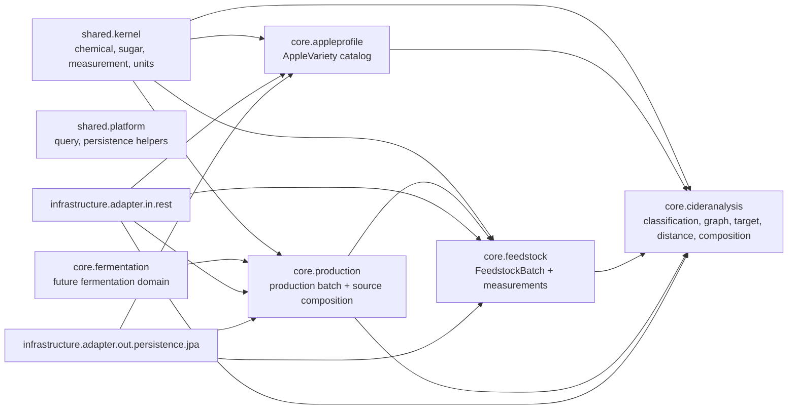

# Project Handoff Context

Architecture overview: [docs/architecture/project-documentation.md](architecture/project-documentation.md).

Документ для переноса контекста в новый чат. Его можно дать следующему
агенту/ассистенту как стартовую память проекта.

Дата среза: 2026-05-14.

## Рабочий стиль и договоренности

- Общаемся на русском.
- Роль ассистента: senior Java architect / production-grade engineer.
- Стек: Java 25, Spring, Gradle, DDD, Hexagonal Architecture, SOLID.
- Java preview features не использовать.
- Предпочтения по коду:
  - records там, где это value/application DTO;
  - immutable by default;
  - rich domain model вместо anemic model;
  - BigDecimal для точных доменных чисел;
  - JSpecify annotations везде, где применимо: `@NonNull`, `@Nullable`;
  - domain model держать framework-light;
  - framework/transport/JPA держать на boundaries.
- Для ручных правок использовать `apply_patch`.
- Для поиска использовать `rg`.
- Не откатывать чужие изменения в dirty worktree.
- OpenAPI контракты и тесты для них не делать заранее; править только по
  отдельному запросу.
- Для strategy classes и реализаций abstraction/classes добавлять комментарии,
  какой подход реализует стратегия.
- Временные решения помечать `TODO`.
- После выполненной задачи всегда писать следующий шаг.

## Текущий git/worktree context

На момент создания этого документа в worktree есть незакоммиченный production
slice:

- изменены:
  - `src/main/java/org/craft/mcs/cap/core/feedstock/domain/model/batch/FeedstockBatch.java`
  - `src/main/java/org/craft/mcs/cap/infrastructure/adapter/out/persistence/jpa/feedstock/JpaFeedstockBatchRepository.java`
  - `src/main/java/org/craft/mcs/cap/infrastructure/adapter/out/persistence/jpa/feedstock/entity/FeedstockBatchJpaMapper.java`
  - `src/main/java/org/craft/mcs/cap/shared/kernel/measurement/VolumeValue.java`
  - `src/main/resources/db/changelog/master-changelog.xml`
- добавлены:
  - `src/main/java/org/craft/mcs/cap/core/production/**`
  - `src/main/java/org/craft/mcs/cap/infrastructure/adapter/in/rest/production/**`
  - `src/main/java/org/craft/mcs/cap/infrastructure/adapter/in/rest/shared/profiletarget/mapper/ProfileTargetRestMapper.java`
  - `src/main/java/org/craft/mcs/cap/infrastructure/adapter/out/persistence/jpa/production/**`
  - `src/main/resources/db/changelog/migration/changelog-03.sql`
  - `src/test/java/org/craft/mcs/cap/production/**`

Последняя проверка после production slice и переноса production DDL в отдельный
changelog:

```bash
./gradlew test
```

Результат был успешный.

## Общая цель продукта

Проект развивается как Cider Analytical Platform: не просто справочник сортов
яблок, а экспертный помощник сидродела.

Направление развития:

1. Каталог сортов и химических профилей.
2. Оценка и визуализация AppleVariety и FeedstockBatch/Measurement на
   sugar-acidity graph.
3. Управление полнотой данных и предупреждения по неполным профилям.
4. Distance/target model для сравнения профилей.
5. Composition calculation и optimization для подбора источников сырья под
   целевой профиль.
6. ProductionBatch как фиксация выбранной композиции и списание объема сырья.
7. Fermentation monitoring, yeast catalog, alerts и экспертные прогнозы.

## Карта контекстов



Важная архитектурная идея: `core.cideranalysis` содержит generic analytical
инструменты. Feedstock/AppleProfile/Production используют их, но не должны
становиться одной большой смешанной моделью.

## Shared kernel

Пакет:

- `shared.kernel.chemical`
- `shared.kernel.chemical.axis`
- `shared.kernel.chemical.capability`
- `shared.kernel.chemical.value`
- `shared.kernel.measurement`
- `shared.kernel.measurement.unit`
- `shared.kernel.sugar`
- `shared.platform.query`
- `shared.platform.persistence`

Смысл:

- `shared.kernel` содержит доменные value objects и примитивы, которые легально
  используются разными bounded contexts.
- `shared.platform` содержит технические/платформенные вещи, например query
  pagination/cursor helpers.

Единицы измерений и соглашения:

- Sugar нормализуется к Specific Gravity, никаких Brix/Plato расчетов не будет.
- Acidity используется как titratable acidity, g/L as malic.
- Tannin используется как mg/L TAE.
- Внутри core слоя есть соглашение, что работаем в нормализованных единицах.
  Поэтому не обязательно указывать unit в именах полей, если тип/контекст уже
  это задает.
- Если в имени поля указывается unit, лучше рассмотреть более сильный тип:
  `AcidityValue`, `TanninValue`, `SugarValue` или специализированный VO.

Решение по production snapshot:

- `ProductionProfileSnapshot` внутри core слоя использует поля `sugar`,
  `acidity`, `tannin`.
- Единицы выражены типами: `SpecificGravityValue`,
  `TitratableAcidityValue`, `TanninityValue`.
- Unit suffix допустим на persistence boundary в именах колонок/полей JPA,
  потому что там важна явная схема хранения.

## ChemicalProfile и capabilities

`ChemicalProfile` допускает неполные данные. Это осознанно:

- для каталога AppleVariety администратор должен видеть отчеты о неполных
  профилях и принимать решение: дополнить, скрыть или исключить из некоторых
  представлений;
- для FeedstockBatch/Measurement неполный профиль является нормальным рабочим
  состоянием, потому что сидродел может постепенно добавлять измерения.

Capabilities:

- `SUGAR_ACIDITY_PLOT`: требует sugar + acidity.
- `NORTH_AMERICAN_PROFILE`: требует sugar + acidity + tannin.
- `SINGLE_VARIETY_CIDER_ASSESSMENT`: требует sugar + acidity + tannin, но
  user story пока отложена.

Важно:

- North American calculator оставлен как отдельный объект, потому что это не
  только классификатор. В будущем он может использоваться в других алгоритмах.
- Для North American endpoint подключена capability check. При нехватке
  показателей endpoint должен возвращать 4xx ProblemDetail, а не server error.

## AppleVariety context

Назначение:

- каталог сортов;
- классификация в разных системах;
- оценка sugar-acidity zone;
- точки на graph;
- будущий catalog discovery.

Важные решения:

- `CreateAppleVarietyUseCase` уже исправлялся: inbound port не должен
  возвращать mutable aggregate наружу.
- Пакет `northamerical` был переименован в `northamerican`.
- `liquibase.drop-first: true` в базовом `application.yaml` был осознанно
  оставлен как временное решение на этапе разработки.
- Seed `apple-varieties.json` сейчас хранит один выбранный chemical profile на
  сорт. Это временно удобно для каталога, но не отражает provenance: разные
  источники, регионы и годы дают разные sugar/acidity/tannin для одного сорта.
  После добавления открытых данных стало видно, что tannin может превышать
  прежний hard limit `4000 mg/L`; `TanninityValue` расширен до `12000 mg/L`.
  Следующий доменный шаг: ввести наблюдения chemical profile для сорта, а
  canonical profile выбирать отдельно.

Knowledge note по provenance:

- `AppleVariety` как сорт должен иметь устойчивую identity и canonical profile
  для быстрых сценариев graph/classification.
- Измерения из источников лучше моделировать как отдельные observations:
  source/reference, year/season, region/location, method, original unit/value,
  normalized `ChemicalProfile`, confidence.
- Canonical profile не обязан быть "последним" значением. Его можно выбирать
  вручную администратором или вычислять policy/strategy: trusted source,
  median/mean, latest complete observation.
- Это особенно важно для tannin: значения зависят от методики и условий
  выращивания сильнее, чем кажется по одному seed-профилю.

Будущие cider-related характеристики AppleVariety:

- синонимы и локальные названия;
- страна/регион/сидровая традиция происхождения;
- сезон созревания;
- рекомендуемый период хранения перед прессованием;
- назначение: single-variety cider, blending/source role, fresh juice, vinegar,
  distillation;
- typical sugar/acidity/tannin/pH ranges;
- source/confidence для химического профиля;
- flavor/technology contribution: body, sharpness, bitterness/astringency,
  aroma intensity.

Не смешивать с orchard-доменом:

- урожайность дерева;
- сила роста;
- опылители;
- устойчивость к болезням;
- климатическая пригодность;
- агротехнические свойства.

## Feedstock context

Ключевой разворот модели:

- сначала много функций было завязано на `FeedstockSample`;
- затем стало понятно, что доменно важнее `FeedstockBatch`;
- `FeedstockMeasurement` теперь лучше понимать как историю измерений
  характеристик `FeedstockBatch`.

Текущая модель:

- `FeedstockBatch`:
  - `batchId`
  - `ciderMakerId`
  - `name`
  - `type`
  - `season`
  - optional `source`
  - `availableVolume`
  - optional `note`
- `FeedstockMeasurement`:
  - `measurementId`
  - `batchId`
  - `name`
  - `chemicalProfile`
  - `measuredAt`
  - optional `note`

Season:

- Используется `FeedstockSeason` как диапазон дат.
- Не используем enum `EARLY/MID/LATE`, потому что такие периоды зависят от
  региона.
- Идея взята ближе к Jolicoeur: season practically определяется датами
  созревания/сбора/прессования, а не абстрактной категорией.

Source:

- `FeedstockSource` опционален.
- Нужен для происхождения сырья: сад, поставщик, ферма, рынок, конкретная
  площадка. Это пригодится для аналитики качества и повторяемости партий.

Volume:

- Добавлен `VolumeValue` в литрах на базе JSR-385/Indriya.
- `FeedstockBatch.availableVolume` используется в composition optimization и
  production.
- Для production slice добавлен `FeedstockBatch.consumeAvailableVolume`.
- В JPA entity для `FeedstockBatch` уже есть `@Version`; репозиторий был
  поправлен так, чтобы обновлять managed entity, сохраняя optimistic locking.

Важно:

- Для graph/assessment по FeedstockBatch обычно использовать latest
  measurement. Старые measurements нужны как история, но не как текущая точка
  сырья.
- Measurement-level endpoints пока оставлены, но в коде есть TODO: решить,
  остаются ли они публичными для historical analysis.

## Sugar-acidity graph и Jolicoeur zones

Источник идеи:

- текст и график Jolicoeur про группы яблок по sugar-acid balance:
  - perfect apples;
  - sugar-rich apples;
  - low-acidity apples;
  - medium-sugar apples;
  - low-sugar apples.

Цель:

- не только классифицировать профили, но и отображать точки AppleVariety и
  FeedstockBatch/Measurement на графике;
- для фронта отдавать не только point, но и metadata: оси, thresholds, зоны,
  geometry.

Важные решения:

- graph metadata и point data должны быть разделены концептуально.
- Graph metadata не должна смешиваться с конкретными точками.
- Zone boundaries должны быть в metadata, иначе frontend не сможет рисовать
  области без hardcode.
- Shape (`RECTANGLE`, `ELLIPSE`) влияет не только на отображение, но и на
  assessor, потому что попадание в rectangle и ellipse считается по-разному.
- Сделаны разные типы SugarAcidityZoneAssessor с общим интерфейсом:
  rectangle и ellipse.
- `BuiltInCiderClassificationThresholds` не должен быть свалкой для всего.
  Sugar-acidity graph/zone/target вынесены в отдельные поддомены.

Текущее разбиение:

- `core.cideranalysis.sugaracidity.graph.domain`
- `core.cideranalysis.sugaracidity.point.domain`
- `core.cideranalysis.sugaracidity.target.domain`
- `core.cideranalysis.sugaracidity.zone.domain`

## Profile target, distance и normalizers

Зачем:

- оценить расстояние химического профиля до целевой области;
- поддержать graph selection;
- поддержать composition optimization;
- позднее similarity search между сырьем и каталогом сортов.

Текущие понятия:

- `ProfileTargetObjective`
- `ProfileTargetDistance`
- `ProfileTargetObjectiveFunction`
- `ProfileTargetObjectiveWeights`
- `ProfileAxisNormalizer`
- `ProfileTargetScoringPurpose`

Scoring purpose:

- `GRAPH_EXPLORATION`
- `BLENDING_PLANNING`
- `TARGET_ZONE_MATCHING`
- `EXPERT_CALIBRATION`

Normalizer strategies:

- `MIN_MAX`: простая нормализация по полному диапазону осей.
- `EFFECTIVE_RANGE`: нормализация по практическим cider ranges.
- `THRESHOLD_SEGMENT`: нормализация по классификационным порогам зон.
- `SENSITIVITY_UNIT`: нормализация по экспертным единицам чувствительности.

Важно:

- Normalizer не должен быть основным пользовательским параметром.
- Для user scenarios лучше выбирать normalizer через purpose/policy.
- В result нужно хранить выбранный normalizer для explainability/audit.
- Tannin опционален, но если участвует в target/distance, он должен
  нормализоваться вместе с sugar/acidity в общей целевой функции, чтобы не было
  математического перекоса.
- Несмотря на то что `ChemicalProfile` может содержать много параметров,
  distance/blending сейчас считаются только по sugar, acidity, optional tannin.

Будущие идеи:

- robust scaling по медиане/IQR;
- z-score по каталогу/региональной выборке;
- target-relative scaling;
- learned/calibrated scoring по историческим успешным решениям.

## Composition calculation и optimization

Терминология:

- `BlendPlan` не использовать для текущего generic расчета raw/source
  composition. Пользователь хочет оставить термин `BlendPlan` для будущего
  купажирования готовых/ферментированных продуктов.
- Для generic результата смешивания chemical axes лучше использовать нейминг
  around `ChemicalProfileComposition`.
- Calculator абстрактен: ему все равно, что смешивается и для чего результат
  будет использован.

Composition calculation:

- Контекст: `core.cideranalysis.composition.calculation`.
- Основной calculator: `MassBalanceChemicalProfileCompositionStrategy`.
- Используется:
  - sugar через gravity points:
    `SG = 1 + weightedAverage((SG_i - 1) * 1000) / 1000`;
  - acidity как concentration mass balance;
  - tannin как concentration mass balance, если политика tannin это позволяет.

Tannin policy:

- `IGNORE_TANNIN`
- `CALCULATE_WHEN_COMPLETE`
- `REQUIRE_TANNIN`

Weights:

- Absolute volume in liters.
- Proportion.
- Нельзя смешивать absolute volumes и proportions в одном calculation.

Практическая польза calculation для заданной source composition:

- проверить, какой chemical profile получится из выбранных источников;
- объяснить, насколько выбранная композиция близка к целевой зоне;
- использовать как preview перед созданием ProductionBatch;
- сохранить snapshot расчетного профиля для audit/reproducibility;
- позже сравнивать план с фактическим результатом fermentation/production.

Optimization:

- Контекст: `core.cideranalysis.composition.optimization`.
- MVP algorithm: `DISCRETIZED_BOUNDED_SEARCH`.
- Это не linear programming, а bounded перебор дискретных пропорций/объемов.
- Search/optimization terminology обсуждалась: слово Search не подходит как
  доменный термин результата, потому что решается задача оптимизации целевой
  функции.

Будущие алгоритмы:

1. Discretized bounded search:
   - перебор пропорций/объемов с шагом 1%/5%;
   - хорошо объясняется и тестируется;
   - подходит для небольшого числа партий.
2. Linear programming:
   - когда objective можно выразить линейно;
   - например минимизировать сумму абсолютных отклонений через auxiliary
     variables.
3. Quadratic/nonlinear optimization:
   - для L2 distance, ellipses, nonlinear quality functions.

Пользовательская логика:

- считать пропорции или считать объемы должно зависеть от явного параметра
  mode, а не выводиться из входных данных.
- Если учитываем volume, используем литры и constraints.
- Если не учитываем volume, считаем как proportions.
- Sugar/acidity обязательны.
- Tannin опционален.

## Production context

ProductionBatch выбран как хороший термин, но важно:

- batch может быть не только для сидра;
- также perry, distillate base/calvados, pommeau и другие beverage/product
  intents.

Текущий production slice:

- Новый context: `core.production`.
- Aggregate: `ProductionBatch`.
- Value/domain classes:
  - `ProductionBatchId`
  - `ProductionBatchName`
  - `ProductionBatchKind`
  - `ProductionBatchStatus`
  - `ProductionSourceComposition`
  - `ProductionSourceComponent`
  - `ProductionProfileSnapshot`
- Use case:
  - `CreateProductionBatchUseCase`
  - `CreateProductionBatchService`
- Persistence:
  - `production_batches`
  - `production_batch_sources`
- REST:
  - `POST /production-batches`

Что делает `POST /production-batches`:

1. Принимает `ciderMakerId`, `name`, `kind`, список источников
   `feedstockBatchId + volumeLiters`, optional target/scoring параметры и note.
2. Загружает `FeedstockBatch`.
3. Проверяет ownership по `ciderMakerId`.
4. Проверяет доступный объем.
5. Берет latest `FeedstockMeasurement` каждого source batch.
6. Проверяет capability `SUGAR_ACIDITY_PLOT`.
7. Считает итоговый profile через `CalculateChemicalProfileCompositionUseCase`.
8. Списывает volume из `FeedstockBatch.availableVolume`.
9. Сохраняет `ProductionBatch` и source composition.

ProblemDetails:

- ownership mismatch -> `403`;
- insufficient available volume -> `422`;
- source profile not usable -> `422`;
- invalid production batch -> `400`.

Важный technical detail:

- `CreateProductionBatchService` не `final`, потому что `@Transactional` через
  Spring/CGLIB proxy иначе ломал context tests.
- `FeedstockBatchJpaEntity` уже имеет `@Version`.
- `JpaFeedstockBatchRepository` был исправлен: при save существующего batch
  он загружает managed entity и обновляет поля через mapper, чтобы optimistic
  locking работал корректно.

Открытый вопрос:

- Сейчас production хранит calculated profile snapshot как BigDecimal поля.
  Нужно решить naming/types:
  - либо `sugar`, `acidity`, `tannin` без unit suffix;
  - либо сильные value objects (`SugarValue`, `AcidityValue`, `TanninValue`);
  - либо reuse/extend existing measurement value objects.

Следующий ожидаемый шаг по production:

- добавить read/query endpoint для `ProductionBatch`, чтобы видеть созданные
  production партии, source composition, рассчитанный profile и связь с
  `FeedstockBatch`.

## Fermentation context

Есть пустой/зачаточный `core.fermentation`.

Смысл будущего домена:

- ProductionBatch отражает не только фазу ферментации, а более общий
  производственный batch.
- Fermentation может быть фазой/процессом внутри production.
- Нужно моделировать операции: fermentation start, measurements over time,
  racking, transfer, bottling, volume adjustments, sample taken.

Важные продуктовые идеи:

- При racking объем меняется: часть уходит с осадком и больше не используется.
- Не всегда нужно создавать новый batch при каждом переливе; возможно нужна
  operation history и current volume.
- Разные технологии: pet-nat, ancestral, keeving, champagne method, still cider,
  pommeau, distillate base.
- Не нужно жестко кодировать все технологии enum-ом слишком рано.

Будущие operations:

- `START_PRODUCTION`
- `START_FERMENTATION`
- `MEASUREMENT`
- `RACKING`
- `TRANSFER`
- `BOTTLING`
- `VOLUME_ADJUSTMENT`
- `SAMPLE_TAKEN`

Volume adjustment reasons:

- evaporation;
- sampling;
- spill;
- racking loss;
- bottling loss;
- manual correction.

## ABV prediction

Уже сделано:

- Potential ABV для FeedstockMeasurement и current FeedstockBatch.
- Входные данные нормируются к SG.
- Brix/Plato calculation не планируется.
- Response содержит method/confidence/assumed final gravity source.

Архитектура:

- FG зависит от вводных параметров, например от характеристик дрожжей.
- Пока yeast domain нет, FG считается через strategy.
- Potential ABV strategy selection уже заложен.

Будущее:

- yeast-aware calculation;
- fermentation-model adjusted calculation;
- measurements-based estimate по time-series fermentation batch measurements.

AppleVariety potential ABV:

- Идея записана как low priority.
- Может быть полезно как reference estimate, но есть риск ложной точности.

## Yeast catalog

Нужно перед полноценными fermentation alerts.

Минимальный `YeastStrain`:

- id;
- name;
- producer optional;
- temperature min/max;
- pH min/max;
- alcohol tolerance;
- expected attenuation optional;
- fermentation speed optional;
- aroma descriptors optional.

Практическая польза:

- yeast-aware FG/ABV prediction;
- alerts по temperature/pH/ABV ranges;
- compatibility checks для production/fermentation batch.

## REST/API overview

Не все endpoints перечислены исчерпывающе, но ключевые:

Apple variety:

- `GET /apple-varieties/{varietyId}/classification?system=...`
- `GET /apple-varieties/{varietyId}/north-american`
- `GET /apple-varieties/{varietyId}/sugar-acidity-zone`
- `POST /apple-varieties/sugar-acidity-zone-points`

Feedstock batch:

- `POST /feedstock-batches`
- `GET /feedstock-batches`
- `POST /feedstock-batches/{batchId}/measurements`
- `GET /feedstock-batches/{batchId}/measurements`
- `GET /feedstock-batches/{batchId}/sugar-acidity-zone`
- `POST /feedstock-batches/sugar-acidity-zone-points`
- `GET /feedstock-batches/{batchId}/abv-prediction`
- `POST /feedstock-batches/profile-target-scores`
- `POST /feedstock-batches/composition-optimizations`

Feedstock measurement historical endpoints:

- `GET /feedstock-measurements/{measurementId}/sugar-acidity-zone`
- `POST /feedstock-measurements/sugar-acidity-zone-points`
- `GET /feedstock-measurements/{measurementId}/abv-prediction`

Composition:

- `POST /chemical-profile-compositions/calculations`
- `POST /chemical-profile-compositions/optimizations`

Production:

- `POST /production-batches`

Sugar-acidity graph metadata:

- `GET /chemical-profiles/sugar-acidity-zone/plot-metadata`

## Persistence / Liquibase

Текущие changelogs:

- `changelog-01.sql`: ранний catalog/appleprofile layer.
- `changelog-02.sql`: feedstock context tables:
  - `feedstock_batches`
  - `feedstock_measurements`
- `changelog-03.sql`: production context tables:
  - `production_batches`
  - `production_batch_sources`

Пользователь попросил отделить production tables в новый changelog, чтобы
визуально разделять контексты. Это сделано.

Миграции в разработке еще можно менять свободно, если пользователь прямо это
подтверждает или контекст говорит, что они еще не применялись.

## Backlog и roadmap

Главные документы:

- `docs/domain/backlog.md`
- `docs/domain/roadmap.md`
- `docs/domain/backlog-mindmap.md`

Roadmap уже частично устарел относительно production slice:

- Phase 1 Distance/Target Model уже в значительной степени сделан.
- Composition calculation/optimization уже есть.
- ProductionBatch foundation начат.

Нужно позже скорректировать roadmap statuses.

Текущие крупные направления:

1. Довести ProductionBatch read/query model.
2. Добавить production operation history/current volume.
3. Добавить минимальный yeast catalog.
4. Добавить fermentation measurements time-series.
5. Добавить yeast-aware alerts.
6. Расширить optimization algorithms за пределы discretized bounded search.
7. Добавить graph discovery через пользовательскую область и export.

## Важные решения по терминологии

- `FeedstockBatch`: партия сырья, у которой есть current/latest chemical
  profile через latest measurement.
- `FeedstockMeasurement`: измерение во времени для batch, история профиля.
- `ProductionBatch`: производственная партия напитка/основы, созданная из
  одного или нескольких feedstock sources.
- `ChemicalProfileComposition`: generic расчет состава chemical axes из
  источников; не знает, будет ли результат production, blending готовых
  продуктов или lab/manual calculation.
- `BlendPlan`: пока не использовать для сырьевой composition. Зарезервировать
  для будущего купажирования готовых/ферментированных продуктов.
- `SourceComposition`: возможный нейтральный термин, но текущий generic слой
  использует `ChemicalProfileComposition`.
- `ProductionSourceComposition`: source composition уже внутри production
  context, когда composition стала производственной партией.

## Известные open questions

1. Production volume semantics:
   - сейчас production creation списывает объем;
   - в будущем может понадобиться reservation model с cancel/change.
2. Production operations:
   - нужен ли отдельный aggregate/child entity для operation history;
   - как моделировать racking/transfer/bottling без преждевременного workflow
     engine.
3. FeedstockMeasurement endpoints:
   - оставить публичными для historical analysis или сузить API вокруг
     FeedstockBatch current profile.
4. Optimizer:
   - добавить LP/nonlinear algorithms позже;
   - выбрать strategy selector по purpose/domain scenario.
5. Normalizers:
   - нужно подобрать лучшие normalizers на реальных данных и экспертной
     разметке.
6. AppleVariety catalog:
   - добавить filter model по classifications;
   - data-quality reports по missing axes.
7. Graph discovery:
   - rectangle selection;
   - linked list of points;
   - CSV/Excel export.

## Как быстро продолжить работу

Если новый чат должен продолжить с текущего места, рекомендованный порядок:

1. Прочитать этот файл.
2. Проверить `git status --short`.
3. Прочитать:
   - `docs/domain/backlog.md`
   - `docs/domain/roadmap.md`
   - `src/main/java/org/craft/mcs/cap/core/production/**`
   - `src/main/java/org/craft/mcs/cap/core/feedstock/domain/model/batch/FeedstockBatch.java`
4. Сделать read/query endpoint для `ProductionBatch`.
6. После каждого изменения запускать минимум:

```bash
./gradlew compileJava
```

Для более уверенной проверки:

```bash
./gradlew test
```
